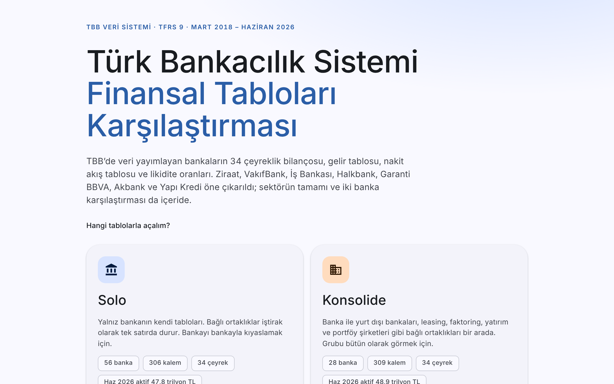
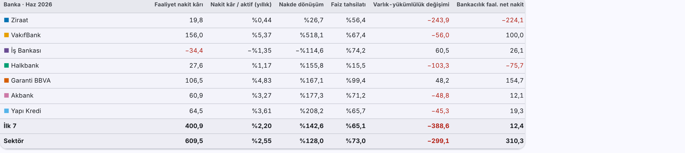

# Türk Bankacılık Sistemi Finansal Tabloları Karşılaştırması

TBB Veri Sistemi'nden (verisistemi.tbb.org.tr) bankaların **TFRS 9 solo ve konsolide** finansal tablolarını
Mart 2018'den bu yana çeyreklik olarak çeken ve tek dosyalık, etkileşimli bir karşılaştırma raporu üreten Python aracı.

**Canlı rapor:** https://resulkonur-gif.github.io/tbb-banka-finansal-tablolar/



## Raporda neler var

* **Solo / konsolide seçimi:** Açılışta hangi tablolarla çalışılacağı seçilir, rapor içinden istenince geçilir.
* **34 çeyrek (Mart 2018 – Haziran 2026):** Yıl ve çeyrek seçici; karşılaştırmalar bir önceki yılın aynı çeyreğine göre.
* **İlk 7 ve sektör:** Ziraat, VakıfBank, İş Bankası, Halkbank, Garanti BBVA, Akbank, Yapı Kredi; TBB'de veri yayımlayan bankaların tamamı ve banka grupları.
* **Nakit yaratma kapasitesi:** Nakit akış tablosundan faaliyet nakit kârı, kârın nakde dönüşüm oranı, faiz tahsilatı oranı ve dönem başı nakitten dönem sonu nakde köprü.
* **Likidite:** Likidite karşılama oranı (LKO) ve net istikrarlı fonlama oranı (NİFO).
* **Mevduat yapısı:** Dipnotlardan mevduatın türlere (tasarruf, döviz tevdiat, ticari ve resmi kuruluşlar, kıymetli maden, bankalar) ve vade dilimlerine göre dağılımı.
* **Yasal özkaynak ve sermaye yeterliliği:** Çekirdek, ilave ana ve katkı sermaye, yasal özkaynak, risk ağırlıklı tutarlar, ÇSYO, ASYO ve SYO; açılır panelde sermaye bileşimi, asgari oranlar ve tamponlara göre fazla, özkaynak dipnotundaki tüm kalemler ve kalem grafiği.
* **İki banka karşılaştırması**, oran haritası, bilanço yapısı ve 300'ü aşkın kalemin tamamını gezme.



## Hızlı başlangıç

**Windows:** `calistir.bat` dosyasına çift tıklayın. Gerekli paketleri kurar, veriyi çeker (5–10 dakika), raporu açar.

**macOS / Linux:**

```bash
bash calistir.sh
```

Gereken: Python 3.9 veya üstü ve internet bağlantısı.

## Otomatik güncelleme

`.github/workflows/guncelle.yml` her ayın 15'inde ve 28'inde GitHub'ın sunucusunda çalışır: veriyi TBB'den çeker, raporu üretir ve veri değiştiyse canlı raporu (`docs/index.html`) günceller. Elle çalıştırmak için depoda **Actions → TBB verisini güncelle → Run workflow**. Her çalıştırmada çekilen ham veri (`tbb_veri.csv`) çalıştırma sayfasından 90 gün indirilebilir.

## Elle kullanım

```bash
pip install playwright pandas openpyxl
playwright install chromium

python tbb_cek.py                                   # 2018-03'ten son döneme, solo + konsolide → tbb_veri.csv
python rapor_olustur.py --excel tbb_veri.xlsx       # → Turk_Bankacilik_Sistemi.html (+ Excel)
```

| Dosya | Görevi |
|---|---|
| `tbb_cek.py` | TBB sayfasını Playwright ile açar, sitenin kendi seçim ve "Rapor Al" fonksiyonlarıyla tabloları çeker |
| `tbb_yardimci.js` | Sayfaya eklenen yardımcı fonksiyonlar (kalem/dönem seçimi, pivot tablodan okuma) |
| `rapor_olustur.py` | CSV'den HTML rapor, düz CSV (`--uzun`), Excel (`--excel`) ve JSON (`--json`) üretir |
| `rapor_sablonu.html` | Rapor şablonu (Material Design, açık/koyu tema, telefona uyumlu) |

`tbb_cek.py` seçenekleri: `--baslangic 201803`, `--bitis 202606`, `--tur solo,kons`, `--parti 6`, `--gorunur`, `--cikti`.

## Yöntem notları

* Tutarlar bin TL olarak çekilir, raporda milyar TL gösterilir; tutarlar nominaldir.
* Gelir tablosu ve nakit akış tablosu yıl başından kümülatiftir; oranlar yıllıklaştırılır (× 12 / ay sayısı).
* Konsolide kalemler (TBB kodu çoğunlukla solo kod + 250.000) solo kalemlerle eşleştirilir.
* TBB bazı dönemlerde LKO, NİFO ve sermaye yeterliliği oranlarını 1.000 ile çarpılmış yayımlıyor; bu dönemler otomatik bulunup düzeltilir.
* Banka listesi TBB'nin bugünkü listesidir; kapanan ya da birleşen bankalar yer almaz.
* Araç TBB sayfasının arayüzüne dayanır; site değişirse `tbb_yardimci.js` güncellenmelidir. Lütfen siteyi gereğinden sık sorgulamayın.

## Kaynak

Veriler [TBB Veri Sistemi](https://verisistemi.tbb.org.tr)'nden çekilmiştir.
